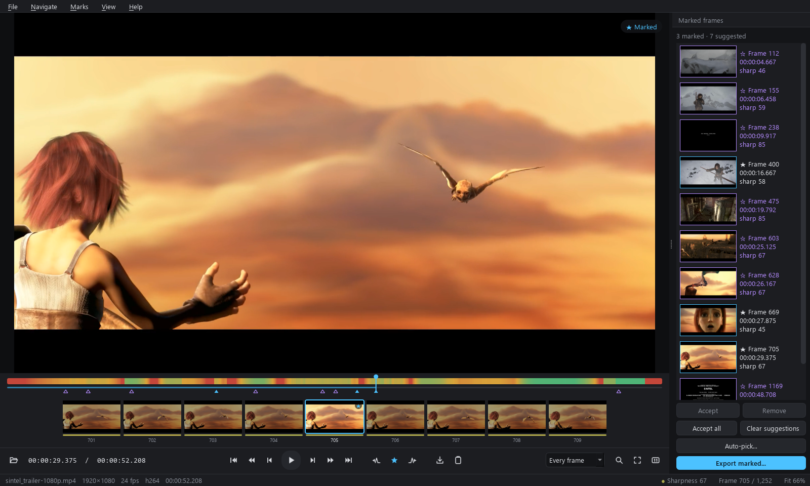
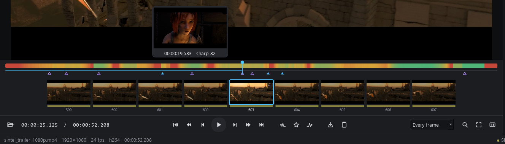
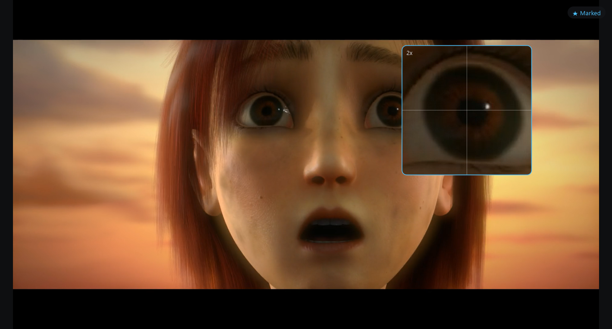
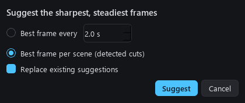
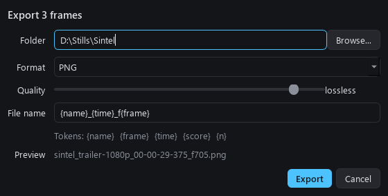

# FrameRipper

Desktop app for browsing a video frame by frame, finding the sharpest stills and exporting them.



- Exact frame stepping, including variable frame rate footage and phone video rotation
- Sharpness heatmap on the timeline, built in the background while you browse
- Jump between local sharpness peaks, or let auto-pick suggest the best frame per N seconds or per scene
- Filmstrip of neighbouring frames, zoom/pan and a 2x pixel loupe for checking focus
- Mark frames, review them in a side panel, batch export with a filename template
- One-key export to PNG, JPG, WebP or TIFF; copy frame to clipboard
- Marks and position are remembered per video; analysis is cached so reopening is instant

## A quick tour

### Find the sharp moments

The strip above the timeline is a sharpness heatmap: green is crisp, amber is soft, red is blurry
or empty (fades, black frames). It fills in while you browse, so you can start straight away.
Hover the timeline for a preview, click or drag to scrub, and press `[` / `]` to hop between the
sharpest frames. The filmstrip under it shows the neighbouring frames with their own sharpness bar.



### Check focus at pixel level

Press `Z` for a 2x loupe that follows the cursor and always reads from the full-resolution frame,
or `2` to view at 100% and drag to pan. Double-click toggles between fit and 100%.



### Mark, auto-pick and export

Press `M` to mark the current frame. Auto-pick (`Ctrl+Shift+A`) suggests the best frame every few
seconds or once per detected scene, preferring sharp, steady frames away from cuts. Suggestions
show as hollow stars; accept the ones you like in the side panel. `S` saves the current frame
straight to your export folder, and `Ctrl+E` exports every marked frame with a filename template.

<table>
  <tr>
    <td></td>
    <td></td>
  </tr>
</table>

## Running

Requires Python 3.12+ and [uv](https://docs.astral.sh/uv/).

```bash
uv sync
uv run frameripper
```

You can also pass a file: `uv run frameripper path/to/video.mp4`, or drag one onto the window.

## Keys

| Key | Action |
|---|---|
| Left / Right | Previous / next frame |
| Shift+Left / Right | Back / forward 1 second |
| Ctrl+Left / Right | Back / forward 10 seconds |
| Home / End | First / last frame |
| Space | Play / pause |
| [ / ] | Previous / next sharp frame |
| M | Mark / unmark frame |
| , / . | Previous / next mark |
| Delete | Remove mark |
| S | Export frame to the export folder |
| Ctrl+Shift+S | Export frame as... |
| Ctrl+E | Export marked frames |
| Ctrl+C | Copy frame to clipboard |
| Ctrl+Shift+A | Auto-pick stills |
| Ctrl+G | Go to frame or time |
| Z | Pixel loupe |
| 1 / 2 | Fit / 100% |
| Mouse wheel | Zoom at cursor (viewer), step frames (timeline, filmstrip) |
| ? or F1 | Shortcut list |

Exports go to `Pictures/FrameRipper` until you pick another folder. Filename templates accept
`{name}`, `{frame}`, `{time}`, `{score}` and `{n}`, with format specs such as `{frame:06d}`.

## How sharpness is scored

Each frame is decoded at 640 px wide in grayscale and split into a tile grid. The score is the mean
Laplacian variance of the sharpest quarter of tiles, so a sharp subject against a soft background
still scores well.

Scores are relative to the rest of the video (0-100), on a log scale between its 5th and 95th
percentiles. That way a few extreme frames, like crisp credit text, don't push everything else
to the bottom. Auto-pick also penalises frame-to-frame motion, avoids frames right next to scene
cuts and skips featureless frames such as black screens.

## Development

```bash
uv run pytest
uv run ruff check src tests
```

Set `FRAMERIPPER_DEBUG=1` to log per-frame decode times.

Layout:

- `video/` frame index (exact per-frame timestamps from a demux pass), decoder with keyframe seek and sequential fast path, LRU frame cache
- `analysis/` sharpness metrics, background analysis thread, auto-pick, on-disk cache
- `export/` filename templates and image writing
- `ui/` Qt widgets and worker threads

## Building a standalone app

```bash
uv run --group build python scripts/build.py
```

Produces `dist/FrameRipper/FrameRipper.exe` (around 180 MB, mostly Qt and FFmpeg).

## Known limits

- Decoding is software only. Random seeks in long-GOP 4K HEVC can take around a second; stepping
  and anything near the current frame is fast.
- HDR video is shown and exported without tone mapping, so it will look washed out.
- Exports are 8-bit, even from 10-bit sources.

## Credits

Screenshots show the [Sintel](https://durian.blender.org) trailer,
(c) copyright Blender Foundation | durian.blender.org, licensed under
[CC BY 3.0](https://creativecommons.org/licenses/by/3.0/).

**And the mandatory LLM disclaimer -** this project has heavy influence from Claude Code (Opus 5.5). 
